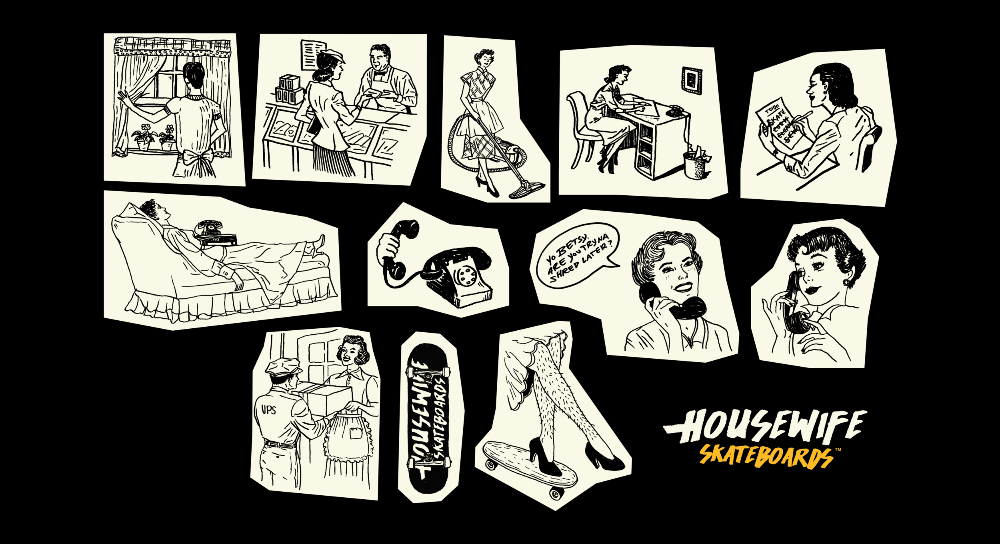
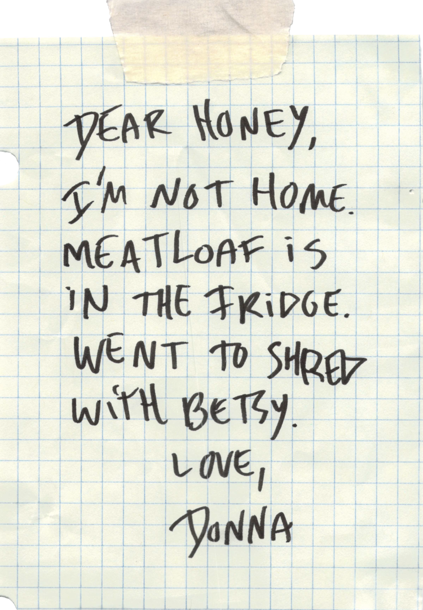

Housewife skateboards reimagines 1950s bored-out-of-their-minds housewives as skaters.

Housewife also sponsors meetups, competitions, and other events around New York City, and collaborates with skate groups like [GRLSWIRL]() and [Quell]().

Housewife decks are manufactured by BBS Manufacturing in California.