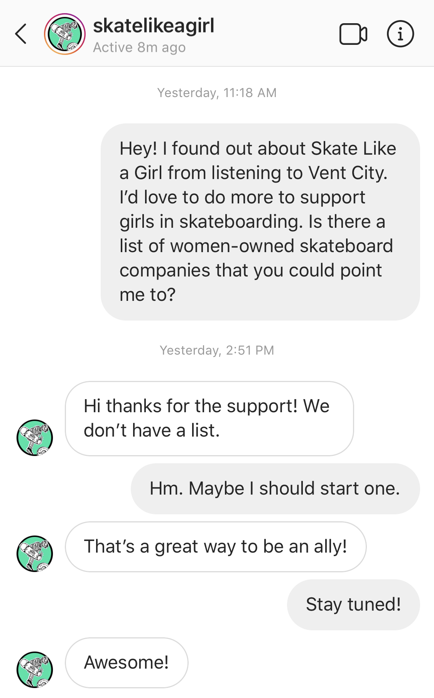

This site exists to make it easier to spend your money at woman-owned skateboard companies.

When I decided I wanted to buy my next deck from a woman-owned company, I couldn’t find any up-to-date lists. I checked with [Skate Like a Girl](https://www.skatelikeagirl.com/), but they didn’t know of any lists either.

So I made this site.

I’ll keep looking for more woman-owned skateboard companies, but if you know of one that isn’t listed here, please [use this form to tell me](https://forms.gle/RjwPpudSo6Ufe9oi9).